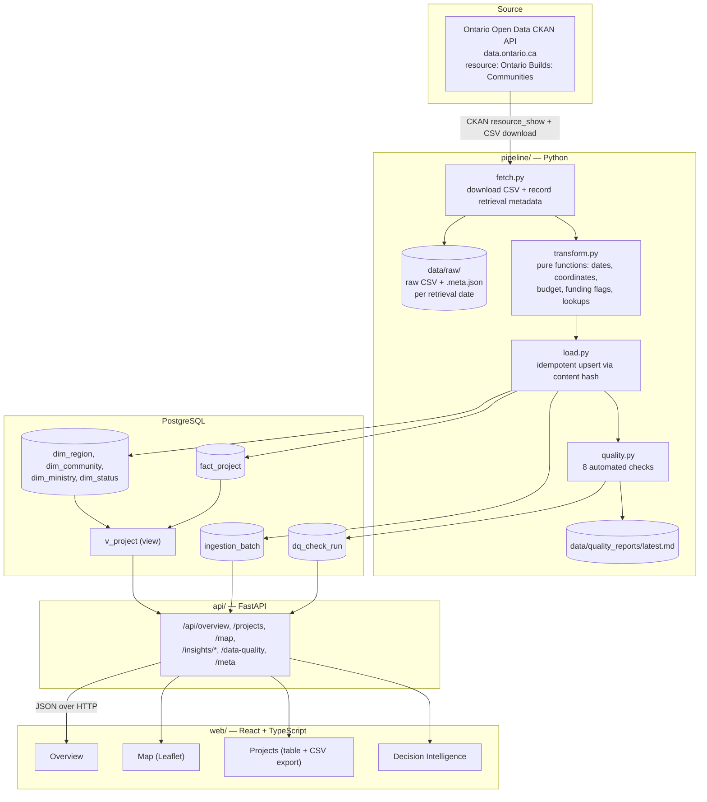

# Architecture

## Pipeline and system diagram



## Why this stack

| Choice | Reasoning |
|---|---|
| **Python for ingestion/validation** | `requests` + `pandas`-free stdlib `csv` is enough for a ~1MB, 21-column source; no need for a heavier ETL framework at this scale. |
| **Plain SQL migrations, not an ORM/migration framework** | The schema is small and stable (4 dimensions + 2 fact-adjacent tables). Numbered `.sql` files in `db/migrations/`, auto-run by Postgres's official Docker image on first boot, give full control over DDL with zero extra tooling. |
| **FastAPI over a heavier framework** | Read-only analytical endpoints over a handful of SQL queries. FastAPI's typing, automatic docs (`/docs`), and `TestClient` made this fast to build and easy to test without an ORM. |
| **psycopg2 directly, no ORM** | Every endpoint is a read against `v_project` or a small aggregate query — an ORM would add indirection without reducing code. |
| **React + TypeScript + Vite, no Next.js** | This is a client-rendered analytical dashboard with no need for server-side rendering, auth, or API routes co-located with the frontend (the FastAPI service already provides the API). Vite keeps the toolchain simple. |
| **Leaflet + OpenStreetMap, not Mapbox/Google Maps** | Zero API key, zero cost, sufficient for pin-and-popup mapping — consistent with the "no paid services" requirement. |
| **Recharts** | Lightweight, composable, good defaults for bar charts without heavy configuration. |
| **Docker Compose for Postgres (+ optional API container)** | Reproducible local setup without requiring everyone to install Postgres natively. The frontend runs via `npm run dev` rather than in a container — faster iteration, and it only needs Node, not a container, to develop. |

## Data flow in one sentence per stage

**Source** (Ontario's live CKAN resource) → **Ingestion** (`fetch.py` downloads the current CSV and records
exactly where it came from and when) → **Validation** (`transform_row` parses each field with explicit
precision/status flags rather than silently coercing) → **Transformation** (dimension lookups, content hash
for identity) → **Database** (idempotent upsert into Postgres) → **Analytics** (`quality.py` runs 8 checks
against the loaded data; `v_project` is the canonical joined view) → **Dashboard** (FastAPI serves `v_project`
and `dq_check_run` as JSON; React renders it).

## Repository layout

```
ont-communities/
├── pipeline/         Python ingestion, transformation, data quality (+ tests)
├── db/migrations/    SQL schema, auto-applied by Docker Compose on first boot
├── data/
│   ├── raw/          Committed raw CSV snapshots + retrieval metadata
│   └── quality_reports/  Generated data quality reports
├── api/              FastAPI analytical API (+ tests)
├── web/              React + TypeScript dashboard (+ tests)
├── docs/             This documentation, plus docs/original-2024/ (preserved original project)
└── docker-compose.yml
```
