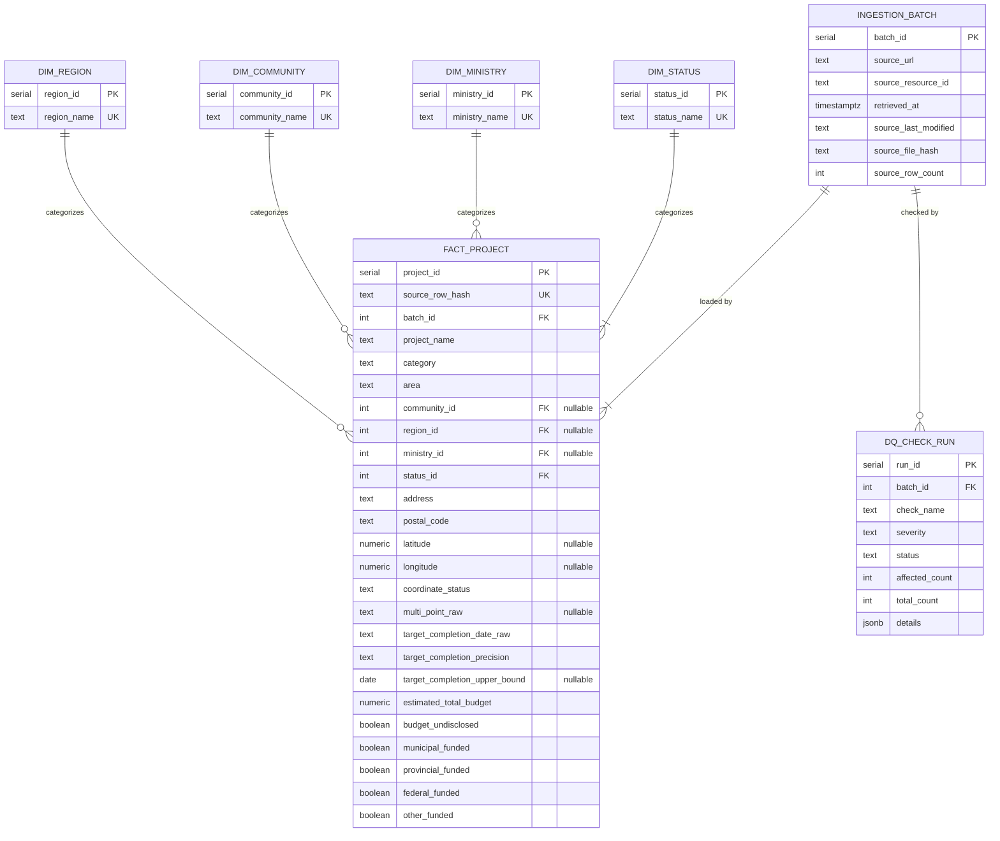

# Entity-Relationship Diagram

Replaces the original hand-drawn ERD (preserved at
[`docs/original-2024/pictures/ONT_ERD.png`](original-2024/pictures/ONT_ERD.png)) with the actual schema in
[`db/migrations/001_schema.sql`](../db/migrations/001_schema.sql). See
[`docs/DATA_DICTIONARY.md`](DATA_DICTIONARY.md) for column-level definitions.

## Design decisions this encodes

- **`fact_project` is the grain of one project record from the source.** There is no project-level history
  table — the source provides no stable ID across snapshots, so a re-ingested update to an existing project
  is a modeling limitation documented in the README, not silently hidden here.
- **`region_id`, `community_id`, and `ministry_id` are nullable foreign keys** — reflecting that ~3% of
  source rows genuinely don't specify a community or region. A `NOT NULL` constraint here would have forced
  either inventing a fake dimension row or silently dropping real records.
- **`area` is a plain column on `fact_project`, not a dimension**, because the audit found 2 communities with
  inconsistent area values in the live source — forcing it into a `dim_area` table would require picking one
  value and hiding the inconsistency.
- **`v_project` (not shown above — see [`db/migrations/002_views.sql`](../db/migrations/002_views.sql)) is a
  plain `JOIN`, not a materialized view** — the dataset is small enough (2,272 rows) that a live join costs
  nothing, and a plain view guarantees the API never serves stale data after a pipeline run.
